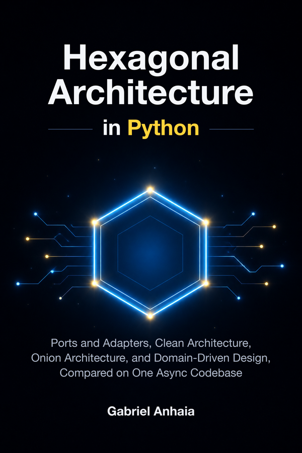

# hexagonal-python-examples

<p align="center">
  
</p>

Companion code for *Hexagonal Architecture in Python* by Gabriel
Anhaia.

Repository: https://github.com/gabrielanhaia/hexagonal-python-examples

Every listing in the book that names a path in this repository is
quoted from it, and every output the book prints was recorded from
it (see `docs/outputs/`).

## What is here

| Directory | What it is |
|---|---|
| `roombook/` | The booking service the book builds: a hexagon with FastAPI, CLI and Kafka driving adapters, SQLAlchemy 2.1 + PostgreSQL 18 driven adapters, a transactional outbox and OpenTelemetry. Parts II, III and V. |
| `architectures/` | Part IV: the same feature built five ways (layered, hexagonal, onion, clean, vertical slice) for comparison. |
| `chNN/` | Chapter-specific snapshots whose code differs from `roombook/` (`ch01`, `ch03`, `ch05`, `ch07`, `ch24`, `ch25`). Each has its own README. |
| `docs/` | `versions.md` (every pin), `troubleshooting.md`, `outputs/` (recorded command output). |

Each top-level project is independent: its own `pyproject.toml`
and `uv.lock`, Python 3.14, exact pins.

## Quickstart

You need Docker with Compose. Nothing else: Python, uv and the
tools are pinned inside the images.

```bash
git clone https://github.com/gabrielanhaia/hexagonal-python-examples
cd hexagonal-python-examples

# Starts PostgreSQL, applies the migrations, runs one command.
docker compose run --rm roombook availability --room atlas --day 2026-12-01
docker compose run --rm roombook hold --room atlas --member member-ada \
    --start 2026-12-01T10:00+00:00 --end 2026-12-01T11:00+00:00
docker compose run --rm roombook expire-holds

# The HTTP API on http://localhost:8000 (OpenAPI at /docs).
docker compose up roombook-api

# Kafka, the Coinwren payment consumer and the outbox relay.
docker compose up roombook-consumer roombook-relay
```

Tests and checks run in the `roombook-dev` service, which mounts
`roombook/` so your edits apply without a rebuild. The PostgreSQL
tests start their own database through the host's Docker socket.

```bash
docker compose run --rm roombook-dev pytest                    # everything
docker compose run --rm roombook-dev pytest -m "not postgres"  # no Docker needed
docker compose run --rm roombook-dev mypy
docker compose run --rm roombook-dev ruff check
docker compose run --rm roombook-dev lint-imports
```

Every other project (`chNN/`, `architectures/`) runs in the
`examples` service: point it at the project directory with `-w`.

```bash
docker compose run --rm -w /repo/ch01 examples pytest -q
docker compose run --rm -w /repo/architectures/clean examples \
    lint-imports --no-logo
docker compose run --rm -w /repo/ch24/step3 examples mypy
```

Configuration is by environment variable; copy `.env.example` to
`.env` to change it. Coinwren is a fictional payment provider: by
default `ROOMBOOK_PAYMENTS=fake` opens pretend checkouts.

## Versions

Every dependency is pinned exactly. `docs/versions.md` records each
pin, why it was chosen and when it was last verified.

## License

The code is MIT licensed; see `LICENSE`. The book is a separate
copyrighted work; no manuscript text is in this repository.
